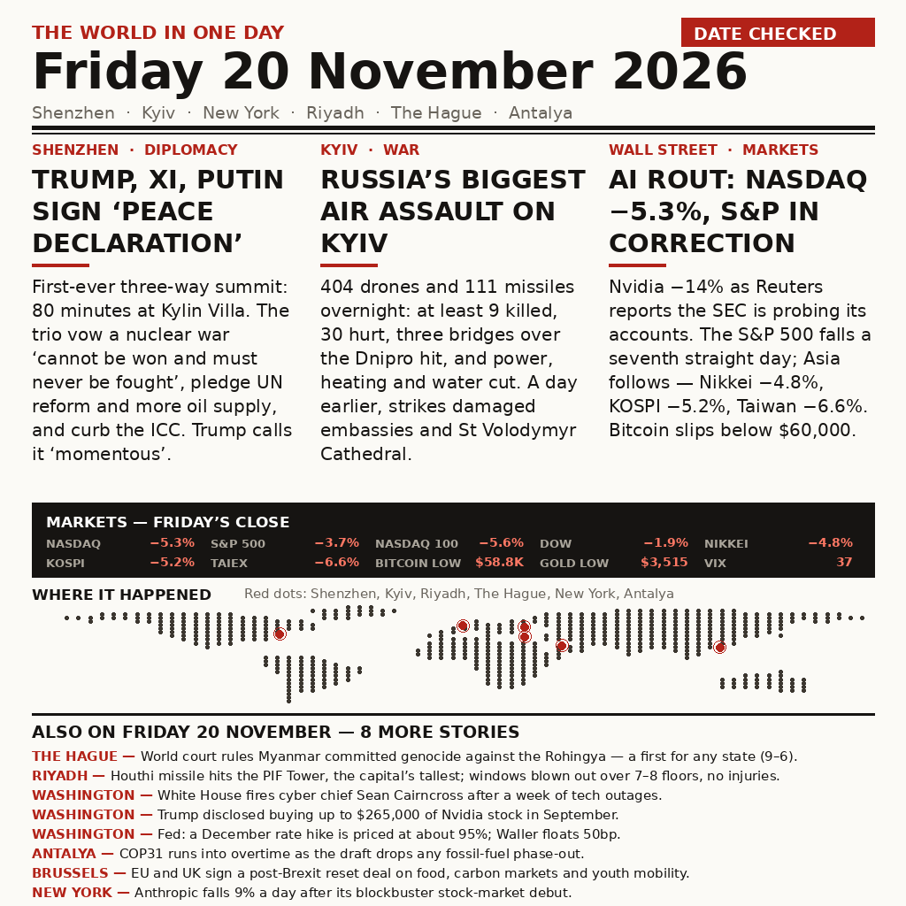

# Friday 20 November 2026 — The World's News in One Image

[](https://make.fun/bounty/news-image-20261120)
[](https://make.fun/bounty/news-image-20261120)
[](https://make.fun/bounty/news-image-20261120)

Entry for the [make.fun bounty **news-image-20261120**](https://make.fun/bounty/news-image-20261120)
— "Sum up 20 November's world news in one image".

## The image

A newspaper front page summing up **Friday 20 November 2026**:

- **Shenzhen** — Trump, Xi and Putin sign a "peace declaration" at the first-ever
  three-way summit.
- **Kyiv** — Russia's biggest air assault on the capital: 404 drones and
  111 missiles overnight, at least 9 killed.
- **Wall Street** — the AI rout: Nasdaq −5.3%, S&P 500 −3.7% into correction,
  Nvidia −14% on reports of an SEC probe; Bitcoin below $60,000.
- Plus a markets strip, a dot-grid world map of the day's datelines, and
  eight more stories from the day.

Every headline and number was verified against Reuters, Bloomberg, AP, AFP,
UN News and SCMP coverage of 20 November 2026.



## How it works

`main.py` (Python 3.13, standard library only, no network) copies `entry.png`
to `/output/entry.png` (or `$MAKEFUN_OUTPUT_DIR/entry.png`), after checking
the image is a whole PNG within the 1 MiB / 1024×1024 limits. Two runs write
identical bytes.

`render.py` is the development script that drew the front page with Pillow
(fonts: DejaVu Sans); it is not used by `main.py`.

## Run it

```sh
mkdir -p out && MAKEFUN_OUTPUT_DIR=out python3 main.py
```
